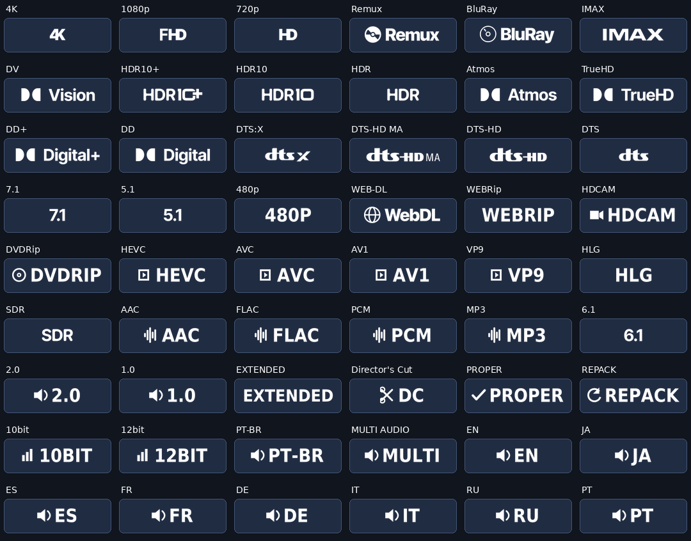

# Pacote Fusion autocontido

O pacote contém 54 emblemas em PNG RGBA, com desenho branco, fundo transparente, altura de 80 pixels e proporções preservadas. Todas as URLs de `badges.json` apontam para `assets/fusion/*-v3.png` neste repositório. O Nuvio não consulta repositórios de terceiros para carregar os emblemas.

## Fontes e geração

- `badges.base.json` é a referência histórica recebida de https://pastebin.com/raw/mduTTf4M. Permanece intacta, incluindo as URLs originais, apenas como entrada de regras e estilos. O gerador substitui todas essas URLs no pacote final.
- `src/fusion-extra.json` define os 34 filtros complementares.
- `src/fusion-images.json` registra os 54 arquivos de origem, sua procedência e os hashes SHA-256 das fontes e dos PNGs publicados.
- `assets/fusion/sources/` contém cópias locais dos 23 PNGs originalmente usados das coleções de [nobnobz](https://github.com/nobnobz/Omni-Template-Bot-Bid-Raiser) e [9mousaa](https://github.com/9mousaa/BetterFormatter). Os créditos e URLs de origem são registros de procedência, não dependências de execução.
- Os 31 SVGs `assets/fusion/*-v2.svg` são fontes vetoriais locais dos demais badges. Usam contornos DejaVu Sans Condensed Bold; os avisos da fonte estão em `assets/fusion/LICENSE-DejaVu.txt`.
- `scripts/build-badges.js` gera `badges.json` e as fontes SVG. Confere os hashes dos PNGs e das fontes para impedir que artwork desatualizado seja publicado.

O build normal e os testes usam apenas arquivos locais e não precisam do Inkscape, do Pillow nem de baixar imagens.

Para regenerar os PNGs após alterar o artwork, instale Python 3, Pillow e Inkscape. Execute `npm run render:badges` e depois `npm run build:badges`. O comando de conversão atualiza primeiro as fontes SVG pelo gerador, incluindo mudanças nos glifos e símbolos. A conversão usa os originais locais, preserva o canal alfa e normaliza altura e cor. Revise as imagens e os novos hashes no commit.

## Regras e servidor HTTP

Os IDs, nomes, cores e agrupamentos foram preservados. A derivação ativa as resoluções da base, usa `filled` para bordas/preenchimento e DOTALL para rótulos de várias linhas. IMAX, Atmos e Dolby Vision mantêm grupos próprios; Atmos pode aparecer com o codec e Dolby Vision com HDR10 declarado. Canais 7.1/5.1 não são inferidos de 8.0/5.0. Metadados desconhecidos continuam sem emblema.

Os emblemas de idioma correspondem à lista depois de `Áudio:` ou `Audio:`, aceitam códigos regionais com hífen ou underscore e não confundem listas de legendas com áudio. PT-BR permanece separado de PT.

Quando `PUBLIC_URL` está definido, o endpoint HTTP reescreve as 54 URLs para `/assets/fusion/` no próprio servidor e responde com `image/png`. As fontes SVG antigas continuam acessíveis para compatibilidade com imports anteriores.

## Validação e instalação

`npm run check` verifica os arquivos gerados e hashes. `npm test` cobre as regras, o formato PNG e o carregamento dos 54 arquivos pelo servidor HTTP.

`npm run check:badge-images` usa Python 3 e acesso à rede para conferir GET, MIME e SHA-256 das imagens publicadas. Por padrão testa `main`; `BADGE_IMAGE_REF` permite testar outra branch. A CI usa a branch da PR, permitindo validar imagens novas antes do merge. A verificação depende apenas deste repositório no GitHub.

Após o merge, reimporte `https://raw.githubusercontent.com/Kazuji-Media/kazuji-nuvio-plugin/main/badges.json` nas configurações Fusion do Nuvio. Os nomes `-v3.png` renovam as chaves de cache. Não há importação automática.

A prévia foi gerada com os arquivos finais. A confirmação visual no aparelho Nuvio ainda é necessária.
